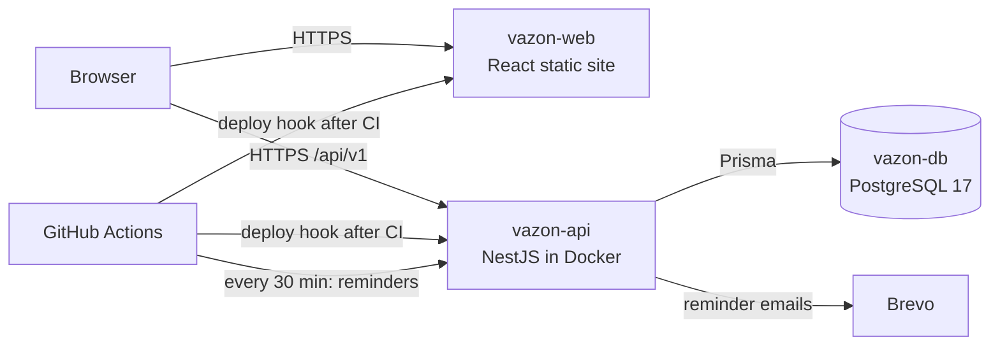

# Vazon

> Houseplant care without the guesswork.

**Live site:** https://vazon-web.onrender.com
**API documentation (Swagger):** https://vazon-api.onrender.com/api/v1/docs

Vazon is a web application that tells houseplant owners what each plant needs today. You add your plants, and Vazon builds a personal watering, feeding and repotting schedule for each one. The schedule depends on the species, the season, the light, the pot size and how close the plant stands to a radiator. Every day you open the "Today" list, do the tasks and tick them off.

Vazon is built by a team of three students at Ukrainian Catholic University for the Object-Oriented Analysis and Design course.

> The site runs on Render's free plan. If nobody has used it for 15 minutes, the server sleeps, and the first page load can take 30 to 60 seconds. After that it is fast.

---

## The problem

Most houseplants die from the wrong amount of water, not from a lack of care. Generic advice such as "water once a week" ignores the things that matter: a cactus and a fern need different care, a plant next to a radiator dries out faster, and in winter most plants need much less water and no feeding. People forget, or water "just in case", and lose plants they liked.

Vazon replaces guesswork with a schedule that adapts to the plant and the conditions it lives in.

---

## What you can do

- **Sign up and sign in** with email and password, or with a Google account.
- **Add plants** by searching a catalog of 93 houseplant species with photos, or enter your own species. Set the room, light, pot size and distance to a radiator, and add a photo.
- **See today's tasks** (water, feed, repot) for all plants, with the recommended amount of water.
- **Log care** with one tap. If you water too early, Vazon asks you to confirm first. A mistaken entry can be undone within 24 hours.
- **Check plant health:** pick the symptoms you see (for example yellow leaves or dry soil), and Vazon suggests likely causes and what to do, based on the care history.
- **View the care history** of each plant.
- **Get reminder emails** once a day at the time you choose, when tasks are due.
- **Use it in English or Ukrainian**, on a phone or a computer.
- **Send feedback** from any page with the feedback button.

---

## How to try it

1. Open https://vazon-web.onrender.com and create an account (or use "Continue with Google").
2. Click **Add plant**, type a species name (for example "Monstera"), pick it from the list and save.
3. Open **Today** to see the tasks for your plants, and mark one as done.
4. Open the plant to see its schedule, history and health check.

---

## Technology stack

| Technology | Version | Role in Vazon |
|---|---|---|
| React | 19.3.1 | User interface |
| React Router | 7.18.5 | Pages and navigation |
| Vite | 8.3.8 | Frontend dev server and build |
| Tailwind CSS | 4.3.5 | Styling |
| i18next / react-i18next | 26.7.2 | English and Ukrainian interface |
| TypeScript | 6.0.3 | Language for frontend and backend |
| Node.js | 24.22.3 (`.nvmrc`) | Runtime |
| NestJS | 12.5.1 | Backend REST API |
| Swagger / OpenAPI (`@nestjs/swagger`) | 12.1.2 | API documentation generated from code |
| Prisma | 7.10.1 | Database access and migrations |
| PostgreSQL | 17 | Database |
| Vitest | 5.1.0 | Unit tests (frontend and backend) |
| Docker and Docker Compose | | Local environment |
| GitHub Actions | | CI (lint, tests, build) and automatic deploys |
| Render | | Hosting of the prototype (free plan) |

Why we chose them: one language (TypeScript) on both sides; NestJS modules, controllers and services match our object-oriented design; our data is relational (users own plants, plants have tasks and history), so PostgreSQL with Prisma fits; Render hosts all three parts for free.

---

## Architecture



- **Frontend (`frontend/`):** pages and forms. All API calls go through `src/services`, and the API address comes from `VITE_API_URL`.
- **Backend (`backend/`):** REST API under `/api/v1`. Thin controllers, business rules in services, input validated with class-validator DTOs.
- **Care schedule engine:** a pure, unit-tested function (`backend/src/care-schedules/schedule.engine.ts`). It takes the plant, the season and past care, and returns due dates. The rules are documented in [docs/care-rules.md](docs/care-rules.md).
- **Database:** schema and migrations in `backend/prisma/`. All times are stored in UTC and shown in `Europe/Kyiv`.
- **Passwords** are hashed with scrypt; they are never stored in plain text. Signed-in requests use a JWT.

The full API contract is in [docs/api.md](docs/api.md).

---

## Project structure

```
vazon/
├── frontend/                 React + Vite + TypeScript + Tailwind CSS
│   ├── src/
│   │   ├── pages/            Landing, Login, Register, Today, Plants, Plant detail, Settings
│   │   ├── components/       reusable UI (plant card, dialogs, feedback widget, ...)
│   │   ├── layouts/          page layout with navigation
│   │   ├── hooks/            auth, care tasks, care logging
│   │   ├── services/         API client: every HTTP call goes through here
│   │   ├── i18n/             English and Ukrainian texts
│   │   └── types/            shared TypeScript types
│   ├── Dockerfile
│   └── nginx.conf            serves the production build in Docker
├── backend/                  NestJS + TypeScript + Prisma
│   ├── src/
│   │   ├── auth/             register, login, Google sign-in, JWT
│   │   ├── users/            users
│   │   ├── plants/           plants and plant photos
│   │   ├── species/          species catalog and search
│   │   ├── care-schedules/   schedule engine and daily tasks
│   │   ├── care-history/     logged care actions, undo
│   │   ├── plant-health/     symptoms and diagnosis
│   │   ├── reminders/        daily reminder emails
│   │   ├── settings/         user settings (language, reminder time)
│   │   ├── feedback/         website feedback
│   │   ├── legal/            privacy policy
│   │   ├── health/           health check
│   │   ├── prisma/, config/, common/
│   │   └── main.ts
│   ├── prisma/               schema.prisma and migrations
│   ├── test/                 end-to-end tests
│   └── Dockerfile
├── infra/                    Render Blueprint (render.yaml), deploy guide, AWS plan
├── docs/                     API contract, care rules, backlog
├── .github/                  CI, deploy and reminder workflows; pull request template
├── docker-compose.yml        PostgreSQL, backend and frontend for local development
├── .env.example              environment variable template (no secrets)
├── CONTRIBUTING.md           team workflow
└── README.md
```

---

## Run it locally (Docker, recommended)

You need [Docker Desktop](https://www.docker.com/products/docker-desktop/) (or Docker Engine with Compose v2) and Git.

```bash
git clone https://github.com/kremeriatko8/vazon.git
cd vazon
cp .env.example .env          # then set your own POSTGRES_PASSWORD (letters and digits only)
docker compose up --build     # the first build takes several minutes
```

Then open:

| What | Address |
|---|---|
| Website | http://localhost:5180 |
| API health check | http://localhost:3100/api/v1/health (returns `{"status":"ok", ...}`) |
| API documentation | http://localhost:3100/api/v1/docs |

Database migrations, including the species catalog, are applied automatically when the backend starts. PostgreSQL is on port 5440. All ports can be changed in `.env`.

```bash
docker compose logs -f backend   # follow backend logs
docker compose stop              # stop, keep data
docker compose down              # remove containers, keep data
```

**Do not use `docker compose down -v`**: it deletes the database volume with all local data.

Never commit `.env`.

### Without Docker

Requires Node.js 24 (`nvm use`) and a running PostgreSQL (for example `docker compose up postgres`).

```bash
# backend
cd backend
cp .env.example .env          # once; set DATABASE_URL (localhost:5440) and JWT_SECRET
npm install
npx prisma migrate deploy
npm run start:dev

# frontend, in a second terminal
cd frontend
npm install
npm run dev
```

Google sign-in and reminder emails are optional locally; without their settings the app works, and emails are written to the backend log.

---

## Deploy

The prototype runs on [Render](https://render.com), free plan, described as code in [infra/render.yaml](infra/render.yaml):

| Render resource | What it is |
|---|---|
| `vazon-web` | Static site built from `frontend/` |
| `vazon-api` | Docker web service from `backend/Dockerfile`; applies migrations on start |
| `vazon-db` | PostgreSQL 17 |

**Automatic deploys:** when a pull request is merged into `main` and CI passes, the workflow [.github/workflows/deploy.yml](.github/workflows/deploy.yml) tells Render to deploy the API and then the website. A few minutes later the change is live for everyone at https://vazon-web.onrender.com. If CI fails (lint, tests or build), nothing is deployed. A deploy can also be started by hand: GitHub > Actions > Deploy to Render > Run workflow.

**First deploy from scratch:** Render dashboard > New > Blueprint > this repository, Blueprint path `infra/render.yaml`. Then set the URLs, Google sign-in, reminder email settings and the GitHub secrets. Step-by-step instructions: [infra/README.md](infra/README.md).

**Limits of the free plan:** the API sleeps after 15 minutes without requests; uploaded plant photos are lost when the API is redeployed or restarted; a free Render database expires after 30 days. A longer-term AWS plan is described in [infra/README.md](infra/README.md) (not built).

---

## Tests and checks

In `frontend/` and in `backend/`:

```bash
npm run lint      # ESLint
npm test          # unit tests
npm run build     # production build
```

Backend end-to-end tests run against a separate PostgreSQL database whose name ends with `_test` (the tests delete every row):

```bash
docker compose exec postgres createdb -U vazon vazon_test   # once

cd backend
export E2E_DATABASE_URL="postgresql://vazon:<POSTGRES_PASSWORD>@localhost:5440/vazon_test?schema=public"
DATABASE_URL="$E2E_DATABASE_URL" npx prisma migrate deploy
npm run test:e2e
```

CI ([.github/workflows/ci.yml](.github/workflows/ci.yml)) runs lint, unit tests, the build and the e2e tests with a throwaway PostgreSQL on every pull request and every push to `main`.

---

## Database

- Schema: `backend/prisma/schema.prisma`; migrations: `backend/prisma/migrations/`.
- Models: `User`, `UserSettings`, `Plant`, `Species`, `CareTask`, `CareHistory`, `Feedback`.
- The species catalog is filled by data migrations. Species photos come from Wikimedia Commons, and the app shows the attribution next to each photo.
- Never edit a migration that has been shared; create a new one.

---

## Team and workflow

Three developers, split by folders so that branches do not conflict:

| Role | Main area |
|---|---|
| Frontend | `frontend/src` pages, components and services |
| Backend, data and infrastructure | care schedules, species, Prisma, `infra/` |
| Auth, security and documentation | sign-in, security, docs |

- `main` is the stable branch and is what runs on the live site. Nobody pushes to `main` directly.
- Work in a branch named `feature/<short-name>` and open a pull request into `main`.
- Lint, tests and the build must pass before merging.

Details: [CONTRIBUTING.md](CONTRIBUTING.md).

---

## Status and known limitations

Working on the live site: sign-up and sign-in (email and Google), plants with photos, species catalog, daily tasks, care logging with undo, care history, health check by symptoms, settings, two languages, feedback form. Reminder emails are implemented; they are delivered once the Brevo settings from [infra/README.md](infra/README.md) are filled in on Render, otherwise they are only written to the API log.

Known limitations:
- The schedule rules are reasonable starting values, not verified botanical data; see [docs/care-rules.md](docs/care-rules.md). The species catalog data still needs checking.
- Plant photos are stored on the API's disk, which the free plan does not keep between deploys. Moving them to S3 is planned.
- The free hosting is slow on the first request after a pause.

Planned next: a species page, QR codes for plant pots, account export and deletion, browser end-to-end tests.
