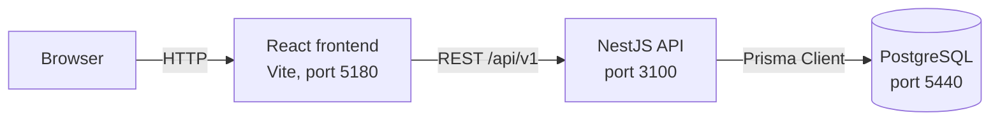

# Vazon

> Houseplant care without the guesswork.

Vazon is a web application that helps houseplant owners look after their plants. It creates a personal watering, feeding and repotting schedule for each plant, based on species, season, light, pot size and distance from a radiator. The daily entry point is a "Today" view with the tasks for that day.

This project is developed by a team of three students at Ukrainian Catholic University (Object-Oriented Analysis and Design course).

---

## Status

| Area | Status |
|---|---|
| Frontend scaffold (React, Vite, TypeScript, Tailwind) | Implemented, placeholder landing page |
| Backend scaffold (NestJS, Swagger, health endpoint) | Implemented |
| Health endpoint `GET /api/v1/health` | Implemented and tested |
| Docker Compose (PostgreSQL, backend, frontend) | Implemented and verified locally |
| Prisma setup | Configured, **no models or migrations yet** |
| Authentication | Planned |
| Plants, care schedules, care history | Planned (module scaffolding next) |
| Reminders | Planned |
| CI, contribution guide | Planned |
| AWS deployment | Planned, not deployed |

Anything marked "Planned" is not implemented yet.

---

## Technology stack and why we chose it

| Technology | Role in Vazon | Why we chose it |
|---|---|---|
| **React** | Frontend UI: pages, forms, plant cards, daily task list | Reusable components suit a dashboard with many similar items (plants, tasks). |
| **TypeScript** | Language for frontend and backend | One language across the project, and type errors are caught before runtime. |
| **Vite** | Frontend dev server and build tool | Fast startup and hot reload during development, with a simple React setup. |
| **Tailwind CSS** | Styling | Consistent spacing and colours with little custom CSS, which helps a small team keep the look uniform. |
| **Node.js 24** | Runtime for frontend tooling and backend | Pinned in `.nvmrc` and `engines` so all developers use the same version. |
| **NestJS** | Backend framework (REST API) | Its modules, controllers, services and dependency injection give a clear structure that matches our design. |
| **class-validator / class-transformer** | Validation of incoming request data | Declarative DTO rules, validated automatically by NestJS pipes. |
| **Swagger / OpenAPI** | API documentation | Generated from the code, so the documentation stays in sync with the endpoints. |
| **PostgreSQL 17** | Database | Our data is relational: users own plants, plants have tasks and a care history. |
| **Prisma ORM** | Database access and migrations | Type-safe queries generated from the schema, and migrations tracked in the repository. |
| **Docker and Docker Compose** | Local environment | Everyone runs the same database, backend and frontend with one command. |
| **GitHub** | Version control, pull requests, code review | Standard workflow for team projects; branches are reviewed before merging. |
| **AWS** (planned) | Future hosting | Managed services for containers and databases. Details are described in `infra/README.md`. |

We pin exact versions for Prisma and key tooling, so all three developers get the same results.

---

## Architecture

The request path is:



Responsibilities of each layer:

- **Frontend (React):** shows pages and forms, sends requests to the API, and displays the results. It holds no business rules that cannot be trusted; the backend makes the final decisions.
- **Backend (NestJS):** exposes the REST API under `/api/v1`, validates input, applies business rules (for example, the care schedule logic), and handles errors consistently.
- **Database access (Prisma):** the only code that talks to PostgreSQL. Schema and migrations live in `backend/prisma/`.
- **Database (PostgreSQL):** stores users, plants, care tasks and history.

---

## Project structure

```
vazon/
├── frontend/              React + Vite + TypeScript + Tailwind CSS
│   ├── src/
│   │   ├── assets/        images and icons
│   │   ├── components/    reusable UI components
│   │   ├── pages/         page components (landing, placeholders)
│   │   ├── layouts/       page layouts
│   │   ├── hooks/         custom React hooks
│   │   ├── services/      API client (all HTTP calls go through here)
│   │   └── types/         shared TypeScript types
│   ├── Dockerfile         development and production images
│   └── nginx.conf         serves the production build
├── backend/               NestJS + TypeScript + Prisma
│   ├── src/
│   │   ├── auth/          authentication (planned)
│   │   ├── users/         users (planned)
│   │   ├── plants/        plants (planned)
│   │   ├── care-schedules/ schedule logic (planned)
│   │   ├── care-history/  care history (planned)
│   │   ├── prisma/        Prisma service
│   │   ├── common/        shared filters, pipes, helpers
│   │   └── app.module.ts  root module
│   ├── prisma/
│   │   └── schema.prisma  database schema
│   ├── test/              end-to-end tests
│   └── Dockerfile
├── infra/                 infrastructure notes (AWS planning, no resources yet)
├── .github/               CI workflows and pull request template (planned)
├── docker-compose.yml     PostgreSQL, backend and frontend services
├── .env.example           template for environment variables (committed)
├── .nvmrc                 Node.js version used by the project
├── CLAUDE.md              project rules for AI-assisted development
├── CONTRIBUTING.md        team workflow (planned)
└── README.md
```

---

## Quick start (Docker, recommended)

### Prerequisites

- [Docker Desktop](https://www.docker.com/products/docker-desktop/) (or Docker Engine with Compose v2)
- Git
- Node.js 24 is only needed if you run the apps without Docker (`nvm use` reads `.nvmrc`)

### Steps

1. Clone the repository:
   ```bash
   git clone <repository-url>
   cd vazon
   ```

2. Create your local environment file:
   ```bash
   cp .env.example .env
   ```

3. Open `.env` and set your own `POSTGRES_PASSWORD`. Use letters and digits only, so it can be used inside a connection string. **Never commit `.env`.**

4. Start everything:
   ```bash
   docker compose up --build
   ```
   The first build takes several minutes.

5. Check that it works:
   - Frontend: http://localhost:5180
   - Backend health check: http://localhost:3100/api/v1/health (should return `{"status":"ok", ...}`)
   - API documentation (Swagger): http://localhost:3100/api/v1/docs

### Ports

| Service | Host port | Notes |
|---|---|---|
| PostgreSQL | 5440 | Changed from 5432 to avoid clashes with other local projects |
| Backend | 3100 | Changed from 3000 |
| Frontend | 5180 | Changed from 5173 |

Change them in `.env` if they clash with something on your machine.

### Useful commands

```bash
docker compose ps                    # show running services
docker compose logs -f backend       # follow backend logs
docker compose stop                  # stop the containers, keep data
docker compose down                  # remove the containers, keep data
```

**Do not use `docker compose down -v`.** The `-v` flag deletes the database volume, and your local data is lost.

---

## Running without Docker (optional)

Make sure PostgreSQL is running (for example, through `docker compose up postgres`), then:

```bash
# backend
cd backend
npm install
npm run start:dev

# frontend (in a second terminal)
cd frontend
npm install
npm run dev
```

The frontend URL is printed in the terminal. The backend reads `DATABASE_URL` from `.env`; for local runs it should point to `localhost:5440`.

---

## Tests and checks

Run these inside each app folder:

```bash
npm run lint      # ESLint
npm test          # unit tests
npm run build     # production build
```

Backend end-to-end tests:

```bash
cd backend
npm run test:e2e
```

Without a database, only the tests that do not need PostgreSQL run; the others are reported as skipped. To run all of them, point `E2E_DATABASE_URL` at a separate test database. Its name must end with `_test`, because the tests delete every row:

```bash
# once: create the test database in the Docker Compose Postgres
docker compose exec postgres createdb -U vazon vazon_test

cd backend
export E2E_DATABASE_URL="postgresql://vazon:<POSTGRES_PASSWORD>@localhost:5440/vazon_test?schema=public"
DATABASE_URL="$E2E_DATABASE_URL" npx prisma migrate deploy
npm run test:e2e
```

CI runs all e2e tests against a throwaway PostgreSQL service (`.github/workflows/ci.yml`).

Before opening a pull request, run lint, tests and the build for the app you changed, and check that `docker compose up --build` still starts.

---

## Database

- Schema: `backend/prisma/schema.prisma`
- Migrations: `backend/prisma/migrations/` (committed to git)
- Models are not defined yet. The first migration will add the initial models.

To apply migrations locally (after the first migration exists):

```bash
docker compose exec backend npx prisma migrate deploy
```

Do not edit an existing migration after it has been shared. Create a new migration instead.

---

## Team and responsibilities

The three developers are assigned roles by the team. Until the assignments are confirmed, the roles are:

| Role | Responsibilities | Main directory |
|---|---|---|
| Developer 1: Frontend | React, UI components, pages, forms, API integration, responsive styling | `frontend/` |
| Developer 2: Backend | NestJS API, authentication, users, plants, care schedules, Prisma models and migrations | `backend/` |
| Developer 3: Infrastructure and integration | Docker, local environment, GitHub Actions, AWS planning, integration testing | `infra/`, `docker-compose.yml`, `.github/` |

Everyone tests their own changes and takes part in code review. The roles are a starting point, not a limit: help each other across areas.

Coordination rules are in `CONTRIBUTING.md` (planned). Until then:

- Work in a feature branch named `feature/<short-name>`.
- Open a pull request into `main`.
- Agree on the API contract with the frontend before implementing a feature that both sides depend on.

---

## Development workflow

- `main` is the stable branch. Nobody pushes feature work directly to `main`.
- Branch names: `feature/frontend-layout`, `feature/auth-api`, `feature/plant-api`, `feature/care-schedules`, `feature/docker-setup`, and so on.
- Each change goes through a pull request with at least one review when possible.
- Keep pull requests small and focused.
- Before merging, lint, tests and the build must pass.

---

## AWS deployment plan (not implemented)

Vazon is not deployed yet, and no AWS resources have been created. The planned architecture is described in `infra/README.md`. In short:

- **Frontend:** static files on S3, served through CloudFront.
- **Backend:** a container on a managed container service.
- **Database:** Amazon RDS for PostgreSQL.
- **Secrets:** AWS Secrets Manager.

Deployment will be decided and documented separately, with cost and security reviewed first.

---

## Current development status

**Implemented**
- Repository structure for frontend, backend and infrastructure
- Frontend scaffold with a placeholder landing page
- Backend scaffold with a health endpoint and Swagger documentation
- Docker Compose setup for PostgreSQL, backend and frontend
- Environment variable template (`.env.example`)

**Tested**
- Frontend lint, type check, unit tests and production build
- Backend lint, type check, unit tests, end-to-end health test and production build
- Docker Compose startup and the health endpoint (verified locally)

**Remaining for development**
- Initial Prisma models and first migration
- Authentication
- Plant management
- Care schedule generation
- Daily tasks ("Today" view)
- Care history
- Reminders

**Remaining for deployment**
- AWS hosting and infrastructure as code (not started)

---

## Next steps

1. Initial database models and migration
2. Authentication
3. Plant management
4. Care schedule generation
5. Daily tasks
6. Care history
7. Notifications
8. User testing and feedback
9. AWS deployment and improvements

---

## Languages and conventions

- Code, comments and commit messages: English
- User interface: Ukrainian and English (to be decided per screen)
- Commit messages follow the Conventional Commits style, for example `feat(plants): add plant creation form`.
